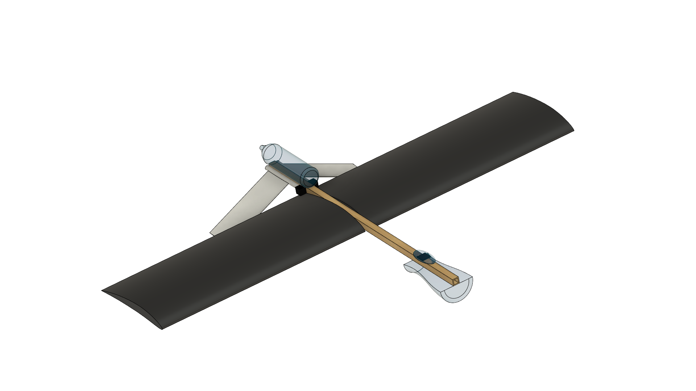
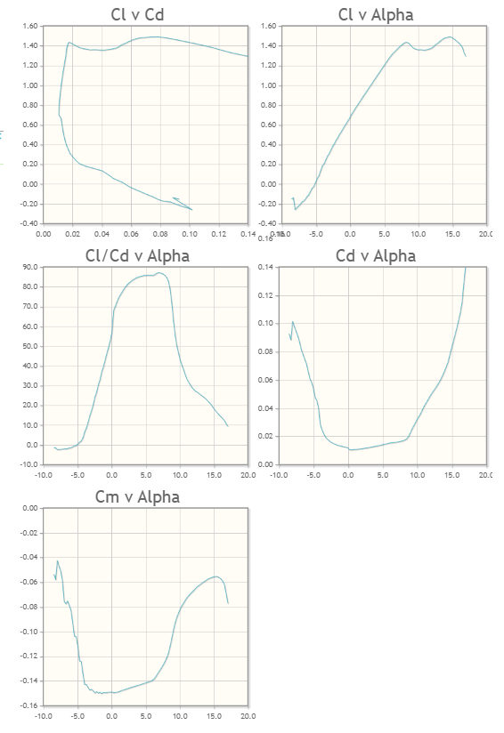
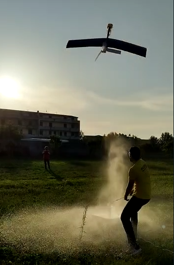
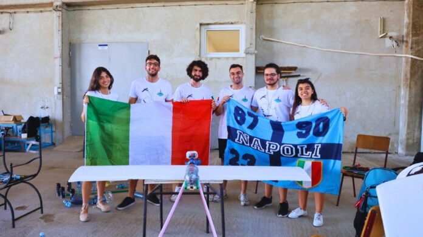

# AIRSloths | Airbus Sloshing Rocket Workshop 2023

**1st Place — Airbus Sloshing Rocket Workshop 2023 | Belgrade, Serbia**  
*Team AIRSloths · University of Naples Federico II · Airbus / EUROAVIA*

> **From concept to flight testing.** AIRSloths designed, built and tested a reusable water-propelled rocket–glider featuring a deployable inverted V-tail and a dedicated liquid-sloshing tank. The project combined aerodynamic design, flight dynamics, computational fluid dynamics, embedded control, and prototype manufacturing under strict mass and budget constraints.

  

## Engineering Report & Presentation

These two principal works document the engineering development and the final competition presentation, respectively. They are placed here for direct access before the technical overview.

| Engineering report | Final presentation |
|---|---|
| [**Design, Testing and Development of a Water-Rocket Glider**](Engineering-Report-and-Presentation/Engineering-Report.pdf) | [**AIRSloths — Airbus Sloshing Rocket Workshop 2023**](Engineering-Report-and-Presentation/Final-Presentation.pdf) |
| Engineering decisions, models, tank-design studies, prototype construction, experiments and lessons learned. | Design approach, sloshing analyses, control concept, manufacturing and final workshop presentation. |

## Mission and aircraft concept

The competition challenged student teams to maximize **flight range, endurance and liquid payload capacity** while managing the destabilizing motion of water in an unpressurized tank. The aircraft needed to launch near vertically and descend without a parachute.

The rocket–glider was developed around **three flight phases**: (1) a rocket-powered ascent, (2) a nose-down transition that builds airspeed after apogee, and (3) a gliding descent. Its **variable-dihedral inverted V-tail** was designed to change its aerodynamic contribution between rocket and glider configurations, providing a controllable pitch-up moment during the transition.

  

*Variable tail geometry: changing the opening angle adjusts the vertical component of tail downforce and the resulting pitching moment.*

## Engineering development

### Aerodynamics and simulation-driven design

The team coupled **Digital DATCOM+** aerodynamic estimates with a **MATLAB flight-dynamics model** to compare configurations, compute mass properties, evaluate longitudinal flight behavior, and refine the geometry. The initial **1.60 m wingspan / 0.35 m chord** did not generate sufficient simulated lift for the desired gliding phase. Design iterations increased these dimensions to approximately **2.00 m / 0.45 m**; the final validation table reports a **2.03 m** span.

  

The NACA 6409 was selected for the main wing. The [archived DATCOM data](Aerodynamic-Data/DATCOM/) include rocket mode and eight labelled glider-mode cases (10°, 20°, 30°, 40°, 50°, 60°, 70° and 75°). Available native input files and aerodynamic outputs are preserved; some cases have fewer export formats than others. See the [data guide](Aerodynamic-Data/README.md) for scope and caveats.

**Related work:** [Simulating Water-Propelled Aircraft for Airbus Sloshing Rocket Workshop — MathWorks Student Blog](https://blogs.mathworks.com/student-lounge/2025/01/07/simulating-water-propelled-aircraft-for-airbus-sloshing-rocket-workshop/), presenting the flight-modelling work developed by **Piercarlo Mirto and Vincenzo Junior Di Rosa**.

### Sloshing mitigation

Liquid motion can change the aircraft's center of gravity and exert transient loads on the tank walls and structure. The team investigated tank dimensions, free-surface motion, and internal baffle arrangements using analytical considerations and **ANSYS Fluent** simulations. A non-symmetric hourglass-inspired tank geometry and a refined baffle configuration were selected as part of the design, balancing fluid mobility, inertial loads, and integration with the aircraft.

See the **Sloshing** section of the [full engineering report](Engineering-Report-and-Presentation/Engineering-Report.pdf) for configurations, CFD snapshots, and the final tank design.

### Propulsion and onboard control

A **2 L PET bottle** with approximately **0.7 L of water** supplied the water-rocket propulsion. The launch mechanism used a guided base, a pressurization circuit, and a fast-release system. For attitude estimation and tail deployment, the prototype integrated an **STM32 NUCLEO-F401RE**, an **X-NUCLEO-IKS01A3** sensor board, servo actuators, and onboard microSD logging.

The embedded system was intended to adjust the tail opening based on estimated attitude. Flight tests identified **pitch-estimation and tail-actuation limitations**, so controlled gliding performance should not be interpreted as fully validated.

## Prototype and flight testing

The team manufactured a lightweight structure using poplar wood, foam lifting surfaces, carbon-fiber spars and 3D-printed parts. The project combined physical testing with iterative redesign.

  

**[Watch the flight-test video on YouTube](https://youtu.be/y8TNEQP7Qss)**

**Measured observations:**

| Test outcome | Reported observation |
|---|---|
| First launch | Approximately **7.5 m** maximum altitude |
| Later test flights | Approximately **10.5–11 m** horizontal range |
| Reusability | Prototype ready for relaunch within **5 min** |
| Development findings | Excess pitching moment associated with sloshing; improvements to tail deployment; launch-guide rigidity and sensor issues |

The first campaign motivated changes to tail-control logic, a **15 cm aft shift** of the sloshing mass, improved avionics protection, and a stiffer aluminum launch guide. The report also describes **additional proposed design modifications** following the second campaign; these should not be mistaken for experimentally verified improvements. Experimental range remained below the design aspirations.

## Prototype overview

| Parameter | Reported value |
|---|---:|
| Take-off mass | **4.1 kg** |
| Overall length | **1.35 m** |
| Wingspan | **2.03 m** |
| Propulsion water | **0.7 L** |
| Documented total cost (including spares) | **€406.82** |
| Competition result | **1st place — ASRW 2023** |

*Values are taken from the competition report / final presentation; the aerodynamic design iteration values and the final measured configuration are shown separately where applicable.*

## Further technical resources

- [**Digital DATCOM+ source configurations and aerodynamic outputs**](Aerodynamic-Data/README.md) — original model inputs, coefficients and archived analysis results for the available rocket/glider cases.
- [**Flight-test footage**](https://youtu.be/y8TNEQP7Qss) — experimental launch video.
- [**MathWorks Student Blog feature**](https://blogs.mathworks.com/student-lounge/2025/01/07/simulating-water-propelled-aircraft-for-airbus-sloshing-rocket-workshop/) — separate MATLAB modelling project (not duplicated here).

## Team and contribution

**AIRSloths:** Maria Mattiello (Team Leader), Pierluca De Felice, **Vincenzo Junior Di Rosa**, Piercarlo Mirto, Maria Giulia Monti, and Gabriele Salomone.

**Vincenzo Junior Di Rosa — contribution:** concept and detailed design, design optimization, and manufacturing, as documented in the team's task allocation; co-development of the MATLAB-based flight-simulation contribution with Piercarlo Mirto. The sloshing CFD and onboard control activities are presented as **team-level work**, not claimed as individual authorship.

## Recognition and media coverage

**Winner — Airbus Sloshing Rocket Workshop 2023**, Belgrade, Serbia.  
[View the official winner certificate](Recognition/Winner-Certificate.pdf)

**Press coverage**

- **Ateneapoli** — *Il prototipo di razzo-aliante ideato e realizzato da un team di 6 studenti federiciani vince una competizione internazionale*, 22 September 2023, p. 16. [Ateneapoli website](https://www.ateneapoli.it/).
- **Tutto Notizie** — *Università, studenti napoletani vincono un prestigioso premio internazionale: “Non era mai successo”*, 8 September 2023. [Read the article](https://tuttonotizie.eu/2023/09/08/universita-studenti-napoletani-vincono-un-prestigioso-premio-internazionale-non-era-mai-successo/).

---

*Historical student competition project (2023). Published here as a technical portfolio case study. Some modelling assumptions and proposed redesigns are not equivalent to experimental verification.*

  

<em>AIRSloths team — Airbus Sloshing Rocket Workshop 2023, Belgrade.</em>

